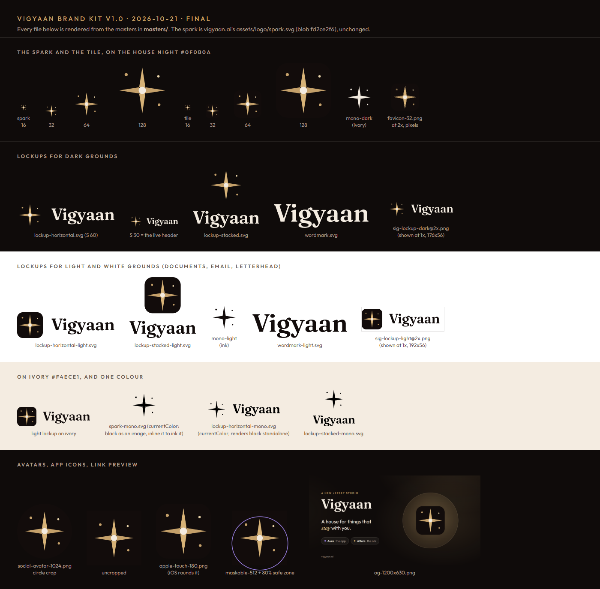

# Vigyaan brand kit, v1.0 (FINAL)

**Version 1.0, set 21 October 2026.** Source: `setukansara-ops/vigyaan-ai-website` at
`ecc9f99e` (PR #20, the redesign that went live on vigyaan.ai that day). The founder
approved the whole kit the same day. His words are in `VERSION`.

**This version is final.** Nothing in this folder is ever edited, re-exported,
replaced or deleted. A change to the mark happens only on the founder's explicit
word, and only as a **new version folder** next to this one (see *Change policy*,
section 12). Every official use of the Vigyaan logo starts from this folder:
documents, email, social profiles, packaging and the website.

---

## 1. What the mark is

**The spark.** A four-point star with a light centre. It is `assets/logo/spark.svg` from
vigyaan.ai, byte for byte. The git blob is `fd2ce2f6`, and the SHA-256 of the file
is `3db12144…c824`.

- Four rays of equal length meet at a centre point, the *bindu*. The two vertical
  rays are a lighter gold than the two horizontal ones, so the eye reads
  "upward" from tone, not from length.
- Three small dots around it are the "night" the spark sits in.
- It is flat: two golds, an ivory centre, and no gradient, glow or bevel.

The comment inside `spark.svg` ("from assets/logo/favicon.svg on main, without its dark
tile") is historical and not exact. The website's `assets/logo/favicon.svg` at `ecc9f99e`
is the older 09-19 geometry: shorter rays, all four rays `#c4a06a`, and other dot
positions. The v1.0 tile is `masters/spark-tile.svg`. The comment stays because
`spark.svg` is kept byte for byte.

The geometry, in a 32-unit box with no background:

| Part | Geometry | Fill |
|---|---|---|
| Top ray | `M16 2.6 L17.8 14 L16 16 L14.2 14 Z` | `#d6b277` |
| Bottom ray | `M16 29.4 L17.8 18 L16 16 L14.2 18 Z` | `#d6b277` |
| Left ray | `M2.6 16 L14 14.2 L16 16 L14 17.8 Z` | `#c4a06a` |
| Right ray | `M29.4 16 L18 14.2 L16 16 L18 17.8 Z` | `#c4a06a` |
| Bindu | circle 16,16, r 2.1 | `#f3ebe0` |
| Dot | circle 6.6,6.8, r 0.9 | `#c4a06a` |
| Dot | circle 25.4,7.8, r 0.7 | `#e8d3a8` |
| Dot | circle 25.8,24.4, r 0.8 | `#c4a06a` |

**The wordmark.** "Vigyaan", in title case only.

- Font: Fraunces SemiBold (wght 600), roman, from Google Fonts v38.
- Optical size 19.52. That is what `font-optical-sizing: auto` gives at the live
  header's 1.22rem. SOFT 0, WONK 0.
- Tracking −0.01em.

**The ™ symbol.** In running text (website, packaging, documents), write Vigyaan™
where the name is used as a brand. Never ®. The logo itself (wordmark, lockups, tile)
carries no symbol. The founder set this on 21 October 2026 (`VERSION`, the `symbol:`
line).

The wordmark is **outlined**. It is not set in type. The paths come from Chrome's own
render of the live header: printed to PDF, where Chrome embeds the exact
variable-font instance as glyph outlines, then turned into paths with PyMuPDF.
So the wordmark never depends on a font file, a font update or a fallback font.
`source/` has the method and the inputs. `verification/` has the comparison with the
live header.

## 2. The files (masters/)

All masters are SVG. "Dark" means a dark ground and "light" means a light or white
ground. **A file without `-light` is for dark grounds.**

| File | What it is | Use it on |
|---|---|---|
| `spark.svg` | The spark, bare. Identical to the live `assets/logo/spark.svg`. | Dark grounds |
| `spark-tile.svg` | The spark 1:1 on a `#120c0b` rounded square (rx 7/32). This is the favicon and app-icon form. | Any ground, and **every ground below 32 px** |
| `spark-tile-square.svg` | The same, full-bleed with no rounding | Platforms that round the corners themselves (the iOS home screen) |
| `spark-avatar.svg` | Full-bleed `#120c0b` square with the spark **scaled to 85%**. Scale is the only change. Every ray tip and dot sits inside a circle crop and inside Android's 80% maskable safe zone. | Social avatars, Android maskable icon |
| `mono-light.svg` | The spark in one colour, ink `#120c0b` | Light grounds, single-ink print, fax |
| `mono-dark.svg` | The spark in one colour, ivory `#f4ece1` | Dark grounds, single-ink |
| `spark-mono.svg` | The spark in one colour, `currentColor` | Foil, emboss, CSS-coloured use |
| `wordmark.svg` / `wordmark-light.svg` / `wordmark-mono.svg` | The outlined word alone, in ivory / ink / `currentColor`. The viewBox is the ink box. | Only where the spark is already present nearby |
| `lockup-horizontal.svg` | **The primary logo**: bare spark and ivory word, drawn from the live desktop header `.brand`, with the baseline fixed at 0.7 S (below, and section 14, item 2). | Dark grounds |
| `lockup-horizontal-light.svg` | The tile and the ink `#120c0b` word | **Light and white grounds** (documents, email, letterhead) |
| `lockup-horizontal-mono.svg` | The horizontal lockup in `currentColor` | One-ink print, foil |
| `lockup-stacked.svg` / `-light.svg` / `-mono.svg` | The spark centred above the word | Square-ish spaces: carton fronts, slides, stickers |

**Geometry of the horizontal lockup** (S is the spark box size; S = 30 in the live header):
- The spark box is S × S at the left.
- The word starts 0.32 S after the box (the header's `.6rem` gap). It is set at 0.65 S
  (the header's 1.22rem).
- The baseline is **0.7 S** below the top of the box (21.0 at S = 30). This is a fixed
  decision. It is where headless Chrome 155 at 4× pixel density paints the live
  header's text. Another renderer can paint the live text lower: in one measured case,
  a second Chromium at 1.5× density, about 1 CSS px lower. The master does not follow
  any renderer. It is the truth.
- The whole lockup is **3.8 S × S** (114 × 30 at header size). The viewBox is
  `0 0 114 30`, so an `` at S = 30 lands on whole pixels.

**The stacked lockup is new in v1.0.** The website did not use it on v1.0's date.
- The spark box S is centred above the word.
- The word is at 0.75× the header scale (em 0.4875 S), so its ink is 1.84 S wide.
- The gap from the bottom of the spark box to the top of the word's ink is 0.22 S.
- The viewBox is `0 0 55.178 50.53` for S = 30.

## 3. The exports (exports/)

Every PNG was rendered from the masters by headless Chrome 155 (Skia).
Lockup PNG names give their **height** (for example `-h256`). Each size in a series
is double the one before it (16, 32, 64 and so on), so the next size up is the @2x
of the one before.

| Folder | Files | Notes |
|---|---|---|
| `spark/` | `spark-{16,32,48,64,128,180,192,256,512,1024}.png` | Transparent. Below 32 px on an unknown ground, use the tile. |
| `tile/` | `spark-tile-{16,…,1024}.png` | Transparent corners |
| `mono/` | `mono-light-` / `mono-dark-{64,128,256,512,1024}.png` | Transparent |
| `lockup/` | `lockup-horizontal[-light]-h{32,48,64,128,256,512,1024}.png`, `lockup-stacked[-light]-h{48,64,128,256,512,1024}.png` | Transparent. No 16 px horizontal lockup: the word would be 10 px, below the minimum. No stacked lockup under 48 px. |
| `icons/` | `favicon-16/32/48.png`, `favicon.ico` (16+32+48, the same pixels), `apple-touch-180.png` (opaque, full-bleed), `android-maskable-192/512.png` (opaque, 85%), `logo-512.png` (the tile) | For the website and app stores. `logo-512.png` is also the company logo wherever a square logo is asked for (Google's JSON-LD, mail and store developer pages). |
| `social/` | `social-avatar-1024.png` (opaque, circle-safe), `og-1200x630.png` (+ `.jpg`, q90) | Avatars everywhere. The link-preview card follows the style of `assets/og/aura.jpg`. |
| `email/` | `sig-lockup-light@2x.png` (384×112, opaque white, shown at **192×56**), `sig-lockup-dark@2x.png` (352×112, opaque `#0f0b0a`, shown at **176×56**) | PNG on purpose, because Gmail and Outlook do not show SVG in mail. The backgrounds are opaque so dark-mode mail apps cannot drop the ink word onto black. |

`contact-sheet.png` shows all of them on their grounds.

## 4. Colours

**The mark (frozen).**

| Name | Hex | Role |
|---|---|---|
| Spark gold, light | `#d6b277` | Vertical rays |
| Spark gold | `#c4a06a` | Horizontal rays, dots, one-colour gold ink |
| Spark gold, soft | `#e8d3a8` | One accent dot |
| Bindu ivory | `#f3ebe0` | Centre |
| Tile / ink | `#120c0b` | The tile, and the word on light grounds |
| House ivory | `#f4ece1` | The word on dark grounds |
| House night | `#0f0b0a` | The ground the mark is designed on (site `--bg`, `theme-color`) |

**For text on white only** (email signature, documents). These are never part of the mark.
- `#5b4f46` warm grey: 7.9:1 on white.
- `#7a5a24` link gold: 6.3:1 on white. This is the spark gold darkened until text is
  readable on white. The spark gold itself is only 2.45:1 on white.

**The website UI is not the mark.**
- The site's `--accent #c9a46a` is a contrast-tuned UI gold. It is deliberately not
  the mark's `#c4a06a`. Never "unify" them, because that changes the mark.
- Other UI tokens: `--accent-soft #ead6ad`, `--muted #ae9e8e`, `--bg-2 #171110`,
  `--surface #1a1312`, `--raised #241a17`.

**The line worlds are not Vigyaan colours.**
- Aura: `#0b0920`, `#a78bfa`, `#7c3aed`, `#c4b5fd`.
- Attars: `#140c11`, `#d9b26a`, `#f0d9a8`.

## 5. Fonts

- **Fraunces** is the display face and the source of the wordmark. Google Fonts v38,
  variable `opsz` 9–144 and `wght` 400–700.
  <https://fonts.google.com/specimen/Fraunces>.
  Fallbacks: `ui-serif, Georgia, serif`.
- **Outfit** is the body face. Google Fonts v15, `wght` 300–600.
  <https://fonts.google.com/specimen/Outfit>.
  Fallbacks: `ui-sans-serif, system-ui, sans-serif`.
- **Email** uses web-safe stacks: Georgia for the name and Arial or Helvetica for the
  details. Mail apps do not load web fonts reliably.
- The site's CSS request is
  `https://fonts.googleapis.com/css2?family=Fraunces:ital,opsz,wght@0,9..144,400..700;1,9..144,400..700&family=Outfit:wght@300..600&display=swap`.
- **Never typeset "Vigyaan" as the logo.** Use the outlined files. In running text the
  name is just a word, in whatever font the text uses, with ™ where it is used as a
  brand (section 1).
- Aura's marketing videos use Segoe UI. That is Aura's ad family, not Vigyaan's.

## 6. Grounds and contrast

- **Dark grounds** (house night `#0f0b0a`, Attars `#140c11`, Aura `#0b0920`, or
  photography dark enough): use the bare spark and the ivory word
  (`lockup-horizontal.svg`).
- **Light or white grounds** (documents, email, letterhead, invoices, white packaging
  panels): use **the tile** and the ink word (`lockup-horizontal-light.svg`). The bare
  gold spark is too faint there. Gold `#c4a06a` is 2.09:1 on ivory and 2.45:1 on
  white. On the tile it is 7.92:1.
- **One ink only:** use `-mono` in gold foil, ink `#120c0b` or ivory `#f4ece1`.

## 7. Clear space and minimum sizes

- **Clear space:** keep at least **0.5 S** clear on every side of a lockup (15 px at
  header size), and at least **0.25 S** around a bare spark or tile.
- **Minimum size on screen:**
  - bare spark 16 px
  - horizontal lockup S ≥ 20 px (the word is then 13 px)
  - stacked lockup ≥ 48 px tall
  - anything ≤ 32 px on an unknown ground uses the **tile**
- **Minimum size in print:**
  - spark ≥ 5 mm
  - horizontal lockup ≥ 18 mm wide (the word is about 8.5 pt)
  - stacked lockup ≥ 12 mm wide

## 8. Do and don't

**Do**
- Use the files as they are, scaled uniformly.
- Pick the ground first, then the matching file: dark gets the bare spark, light gets
  the tile.
- Use PNG where SVG is not supported: email, Office on older versions, upload forms.

**Don't**
- Redraw, retrace or "clean up" the spark or the word. Don't re-type the word in Fraunces.
- Recolour the mark, including into a line's colours. Use only the three mono inks.
- Stretch, squash, rotate, skew, outline or crop the mark.
- Add effects: glow, shadow, bevel, gradient, texture or 3-D. The faceted 3-D star of the
  retired `assets/og.jpg` (section 10) is exactly this mistake.
- Put the bare gold spark on white or ivory.
- Set the name in capitals ("VIGYAAN") or in a sans-serif as a logo.
- Add ™ or ® to the logo. ™ goes in running text only, and ® never (section 1).
- Rearrange the lockup (word on the left, a different gap or size) or invent new
  lockups. Horizontal and stacked are the only two.
- Mix it with the Aura icon. **Aura is a separate brand**, with its own icon, its own
  violet world and its own ads. Aura says "by Vigyaan" in text and never shows the
  spark.

## 9. Where each file goes

| Use | File |
|---|---|
| Website header and footer | `assets/logo/spark.svg` (= `masters/spark.svg`) |
| Website favicon (SVG) | `masters/spark-tile.svg` |
| Favicon PNG and ICO | `exports/icons/favicon-32.png`, `favicon.ico` |
| iPhone home screen | `exports/icons/apple-touch-180.png` |
| Android / PWA | `exports/icons/android-maskable-192/512.png` |
| Google company logo (JSON-LD `Organization.logo`) | `exports/icons/logo-512.png` |
| Link previews (`og:image`) | `exports/social/og-1200x630.jpg` |
| Email signature | `exports/email/sig-lockup-light@2x.png`, shown at 192×56. The signature HTML is in the kit's `signature/` folder, which the website does not serve. |
| Social profile pictures and organisation logos | `exports/social/social-avatar-1024.png`, or `exports/icons/logo-512.png` where a square logo is asked for |
| Documents, letterhead, invoices, decks on white | `masters/lockup-horizontal-light.svg` (PNG `lockup-horizontal-light-h256/512`). One ink: `lockup-horizontal-mono.svg` or `mono-light.svg`. |
| Dark slides and Vigyaan (not Aura) end cards | `lockup-horizontal.svg`, `lockup-stacked.svg` |
| Attar packaging (cartons, bottle wraps, labels) | `spark-mono.svg` / `lockup-stacked-mono.svg` / `lockup-horizontal-mono.svg` in gold foil or ivory, on the Attars plum-black `#140c11` |
| Aura app, Aura ads, Aura flyers | **Not this kit.** Aura has its own icon. |

## 10. Retired marks. Never use these.

They are retired by v1.0 and must not be used for anything new. On 2026-10-21, this
version's date, the files were still in the website repo. None was referenced by a live
page except `assets/og.jpg` (the `og:image` of `/` and `/studio/`) and the 09-19 PNGs
`assets/logo/favicon-32.png`, `apple-touch-180.png` (both linked by every page) and
`vigyaan-mark-512.png` (the home page's JSON-LD logo), pending a swap to the v1.0 files
in section 9. The swap's status is tracked outside this frozen folder.

- `assets/brand/mark.png` and `assets/logo/dp-warm-oil-stars-1024.png`: the 09-19
  oil-and-starfield painting. The two files are byte-identical.
- The 2026-10-21 contents of `assets/logo/favicon-32.png`, `apple-touch-180.png` and
  `vigyaan-mark-512.png`: the same painting at icon sizes. A swap replaces those
  contents with the v1.0 exports. The paths themselves can stay.
- `assets/logo/dp-warm-oil-1024.png`, `dp-warm-gold-1024.png`, `dp-warm-rings-1024.png`,
  `dp-dark-1024.png`, `dp-gradient-1024.png`, `dp-wordmark-1024.png`: the 09-19
  avatar experiments.
- `assets/logo/vigyaan-mark.svg` (the 05-19 blue-violet-green lozenge spark),
  `vigyaan-mark-mono.svg` (its one-colour form) and `vigyaan-icon.svg` (it on a gradient
  tile).
- `assets/og.jpg`: the faceted 3-D gold star with "VIGYAAN" in spaced caps.

## 11. Checking the files

`SHA256SUMS` lists every file in this folder except itself (GNU `sha256sum` format).
Its own SHA-256 is pinned outside the folder, in two places: the kit's `../README.md`
and `SUMS_SHA` in the website repo's `tools/lint.mjs`. So a changed file cannot pass by
also changing its line in `SHA256SUMS`: that changes the pin, and the pin lives in a
file someone has to edit visibly.
- PowerShell: `powershell -ExecutionPolicy Bypass -File verify.ps1` checks the pin, then
  every file. It prints `ALL OK` or names each file that changed or is missing.
- Git Bash: `cd v1.0 && sha256sum SHA256SUMS && sha256sum -c SHA256SUMS`. Compare the first
  line's hash with the pin by eye.

All files carry the Windows **read-only** attribute (`attrib +R`). That stops
accidental saves. It is not a lock: Git Bash's `rm -f` ignores it. The pinned checksums,
the copy in the website repo and its lint gate are the real guard.

**The website repo** (`setukansara-ops/vigyaan-ai-website`, folder `brand/v1.0/`) holds
every file in this folder at the same relative paths.
- The website serves all of it at `https://vigyaan.ai/brand/v1.0/…` except `source/`,
  `verification/`, `signature/` and `verify.ps1`. Those are versioned in the repo but
  left out of the deploy by `.vercelignore`. On a copy downloaded from the website, use
  `sha256sum -c --ignore-missing SHA256SUMS`.
- `brand/.gitattributes` marks the copy as binary, so git never rewrites its line
  endings.
- `node tools/lint.mjs` fails if:
  - `SHA256SUMS` is not the pinned `SUMS_SHA`
  - any file there stops matching `SHA256SUMS`, a file is not listed, or a listed
    file is missing
  - `VERSION` still says the founder's approval is pending
  - `assets/logo/spark.svg` stops matching `masters/spark.svg`
  - a page renders a retired mark
- The site has no CI. The gate runs whenever the lint is run.

## 12. Change policy

1. **v1.0 is final.** Its files are never edited, re-exported, replaced or deleted,
   here or under `/brand/v1.0/` on the website. Emails already sent load their logo
   from that URL.
2. **The mark changes only on the founder's explicit word**: a message from him that
   says to change the logo. A redesign idea, a "cleaner" export or a helper's
   suggestion is not that word. **Every new folder, `v1.0.1/` included, needs the
   founder's explicit word.**
3. **A change is a new version folder** (`v1.1/` or `v2.0/`) next to `v1.0/`, built
   from that decision. It has its own `VERSION` (with the date and his words),
   `SHA256SUMS` and a "what changed" note. **A new folder is a complete kit, never a
   delta**: it holds every file, changed or not. `../README.md` then points at the new
   folder. Nothing is overwritten.
4. A missing size or format is also a new version (`v1.0.1/`), never a quiet addition
   to `v1.0/`.
5. **The PR that adds a new folder also updates the gate.** It adds the folder to
   `tools/lint.mjs` (`KITS`: its path and its `SUMS_SHA`; `SPARK_SHA` if the spark
   changed) and moves the `/brand/` page links to it. v1.0 stays in `KITS`, because
   v1.0 never changes.
6. Anyone preparing a file with the mark, a person or a tool (AI assistants included),
   **copies from this folder and never redraws**. If something needed is missing, they
   say so and ask the founder. They do not improvise a variant.

## 13. Provenance and proof

The full write-up is in `verification/README.md`. Every measurement below was made in
headless Chrome 155 at 4× pixel density, the renderer the masters were built in.
- At 10× scale, the outlined wordmark lands on **the same ink box** as that renderer's
  live Fraunces text (39.9, 7.2 → 113.4, 25.8), with a mean pixel difference of
  0.25/255.
- In the live vigyaan.ai header, the spark region is **pixel-identical**. The text
  differs by a mean of 1.9/255 and never by more than 124/255, with a best shift of
  0, 0.
- That match holds for that renderer. A second Chromium (1.5× density, live Fraunces)
  painted the live text about 1 CSS px lower than the master, with the same horizontal
  extent and an identical spark. The difference is invisible at 30 px, and the master's
  baseline is a fixed decision (section 2).

Build:
- headless Chrome 155.0.8059.80 on Windows 11
- PyMuPDF 1.28.0
- Pillow 12.2.0
- node 24.16.0

## 14. Declared gaps

1. On phones (under 400 px), the live header sets the word at 1.12rem (0.597 S) next to
   the same 30 px spark. The footer sets it at 1.3rem with no tracking. The masters
   follow the desktop header (1.22rem, −0.01em). Neither CSS rule was changed.
2. Renderers place a text baseline differently. In headless Chrome 155 at 4× density,
   the desktop header lays the baseline out at 21.39 px below the top of the spark and
   paints it at 21.0. The master fixes the baseline at **21.0** (0.7 S) as a decision.
   One other renderer measured (a second Chromium at 1.5× density) painted the live
   text about 1 CSS px lower. The master does not move with any renderer.
3. PNGs re-rendered on another machine or browser may differ by antialiasing pixels.
   The SVG masters are the truth.
